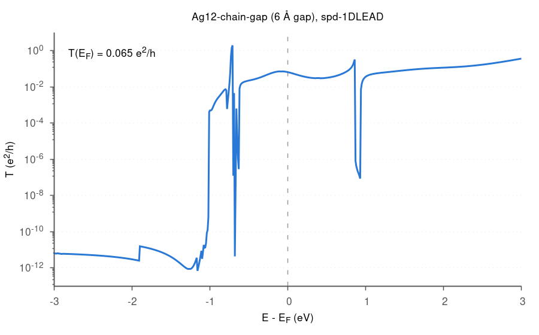

Ag chain (Ag12-chain-gap, 12 atoms, 6 A gap in the middle) between one-dimensional leads, LSDA, with
a minimal spd basis.

Each atom has one contracted s, p and d shell and an ECP with a 36-electron core (11 valence
electrons), given in the input through `gen` and `pseudo=read`.

## Running the example

The calculation runs in two steps that share the checkpoint `Ag12-chain-gap.chk`:

1. Run `Ag12-chain-gap.qc.gjf` with plain Gaussian (no ANT links). It runs quadratically convergent
   SCF to a loose threshold, `scf=(qc,maxcycle=512,conver=3) nosymm`, and writes
   `Ag12-chain-gap.chk`.
2. Run `Ag12-chain-gap.gjf` with `Ag12-chain-gap.ant`. It reads the starting orbitals from the
   checkpoint (`guess=read`) and does the ANT calculation with
   `scf=(maxcycle=300,conver=5,nodamp) nosymm`.

Both steps use `nosymm`, so Gaussian keeps the input orientation and atom order, which the 1D leads
rely on. Step 1 must end normally, because Gaussian writes the basis set to the checkpoint only
then. Step 2 overwrites the checkpoint, so run step 1 again before repeating step 2.

Step 2 also writes `P.Ag12-chain-gap.dat`. ANT reads that file at start-up as the initial density
matrix, so delete it before repeating step 2 from the checkpoint. It is not included here.

`.ant` settings: `TYPE1 = TYPE2 = 1DLEAD`, `NATPC1 = NATPC2 = 3` (a 3-atom, 9 A repeated unit),
`NPC = 1` (couplings only to the neighbouring unit), `PACC = 1.0d-7`, `CHARGEACC` and `FERMIACC`
1.0d-5.

## Outputs

- `Ag12-chain-gap.qc.log`: step 1
- `Ag12-chain-gap.log`: step 2
- `T.Ag12-chain-gap.dat`: transmission for E - E_F = -3 to 3 eV in 0.01 eV steps, in units of
  e^2/h
- `T.Ag12-chain-gap.png`: plot of the transmission (log scale), shown below
- `Ag12-chain-gap.xyz`: empty; ANT writes no geometry with 1D leads

## Results

ANT.Gaussian 3.0.0, Gaussian 09 D.01, NVIDIA HPC SDK build, 8 threads, 14 November 2026.

| | Step 1 (QC) | Step 2 (ANT) |
|---|---|---|
| Basis functions | 108 | 108 |
| SCF energy (a.u.) | -467.324251 | -467.193631 |
| SCF cycles | 2 | 11 |
| Wall time | | 6 s |

| Quantity | Value |
|---|---|
| Lead Fermi energy (eV) | -5.8946 |
| Device Fermi energy (eV) | -6.0107 |
| T(E_F) (e^2/h) | 0.0649 |
| T at E_F - 1 eV / E_F + 1 eV (e^2/h) | 0.0005 / 0.036 |
| Unsuccessful density integrations | 4 (early cycles) |

The run terminates normally. The device Fermi search counts the 66 electrons of the 6 atoms between
the two lead units (atoms 4-9).

## Notes

- The transmission is about 1e-11 below E - E_F = -1.05 eV and rises above it; through the 6 A gap
  it stays below 0.4 e^2/h up to E_F + 3 eV.
- The leads are extracted from atoms 1-6 and 7-12. Only two units fit on each side, and the outer
  atom (1, 12) and the atom at the gap (6, 7) have on-site energies that differ by up to 0.17 eV
  from the others, so the extracted leads are only approximately periodic. A longer chain would give
  a cleaner lead.
- The `.gjf` files use `%NProcShared=8`; change it to the number of cores available. Step 2
  substitutes links from `../../../../bin`.
