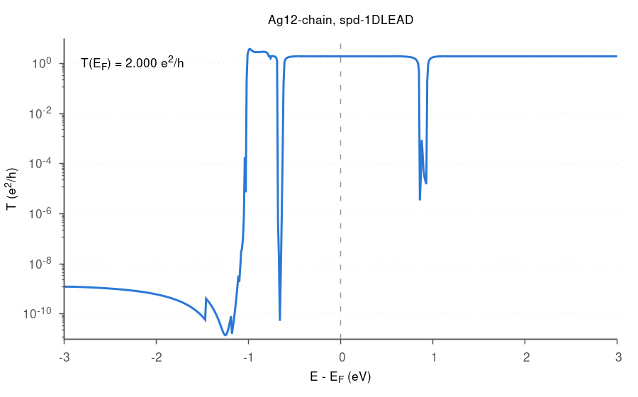

Ag chain (Ag12-chain, 12 atoms, uniform 3 A spacing) between one-dimensional leads, LSDA, with
a minimal spd basis.

Each atom has one contracted s, p and d shell and an ECP with a 36-electron core (11 valence
electrons), given in the input through `gen` and `pseudo=read`. Inputs and settings are those of
[../../Ag12-chain-gap/spd-1DLEAD](../../Ag12-chain-gap/spd-1DLEAD/README.md) with the gap closed.

## Running the example

The calculation runs in two steps that share the checkpoint `Ag12-chain.chk`:

1. Run `Ag12-chain.qc.gjf` with plain Gaussian (no ANT links):
   `scf=(qc,maxcycle=512,conver=3) nosymm`. It writes `Ag12-chain.chk`.
2. Run `Ag12-chain.gjf` with `Ag12-chain.ant`, starting from the checkpoint
   (`guess=read`) with `scf=(maxcycle=300,conver=5,nodamp) nosymm`.

Step 1 must end normally, because Gaussian writes the basis set to the checkpoint only then. Step 2
overwrites the checkpoint and writes `P.Ag12-chain.dat`, which ANT reads at start-up; delete
it and rerun step 1 before repeating step 2. It is not included here.

`.ant` settings: `TYPE1 = TYPE2 = 1DLEAD`, `NATPC1 = NATPC2 = 3`, `NPC = 1`, `PACC = 1.0d-7`,
`CHARGEACC` and `FERMIACC` 1.0d-5.

## Outputs

- `Ag12-chain.qc.log`: step 1
- `Ag12-chain.log`: step 2
- `T.Ag12-chain.dat`: transmission for E - E_F = -3 to 3 eV in 0.01 eV steps, in units of
  e^2/h
- `T.Ag12-chain.png`: plot of the transmission (log scale), shown below
- `Ag12-chain.xyz`: empty; ANT writes no geometry with 1D leads

## Results

ANT.Gaussian 3.0.0, Gaussian 09 D.01, NVIDIA HPC SDK build, 8 threads, 14 November 2026.

| | Step 1 (QC) | Step 2 (ANT) |
|---|---|---|
| Basis functions | 108 | 108 |
| SCF energy (a.u.) | -467.343707 | -467.308627 |
| SCF cycles | 1 | 22 |
| Wall time | | 25 s |

| Quantity | Value |
|---|---|
| Lead Fermi energy (eV) | -5.0845 |
| Device Fermi energy (eV) | -5.1326 |
| T(E_F) (e^2/h) | 2.000 |
| T at E_F - 1 eV / E_F + 1 eV (e^2/h) | 3.244 / 1.786 |
| Unsuccessful density integrations | 5 (early cycles) |

The run terminates normally. Each atom holds 10.97-11.06 electrons, and the on-site energies of
atoms 4-9 agree within 0.03 eV.

## Notes

- T(E_F) = 2.000 e^2/h is one fully open spin-degenerate channel, G = 1 G0, as expected for a
  monovalent atomic chain. Across most of the window it stays close to 2.
- Two narrow windows have essentially zero transmission: E - E_F = -0.68 to -0.63 eV (down to
  5e-11) and +0.86 to +0.93 eV (below 1e-3). They are most likely minigaps of the extracted lead,
  opened because the 3-atom units taken from a 12-atom cluster are not exactly periodic; a perfect
  chain would have no gap there.
- Below E - E_F = -1.05 eV the transmission drops to 1e-9 or less, as it does in Ag12-chain-gap, so
  this edge comes from the extracted lead bands, not from the gap.
- Compared with [Ag12-chain-gap](../../Ag12-chain-gap/spd-1DLEAD/README.md) (T(E_F) = 0.065), the 6
  A gap reduces T(E_F) by a factor of about 30.
- The `.gjf` files use `%NProcShared=8`. Step 2 substitutes links from `../../../../bin`.
