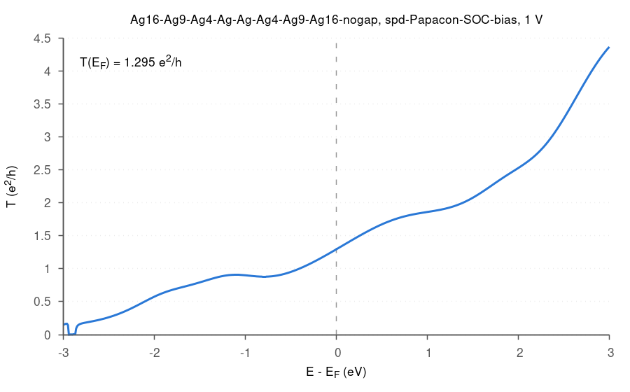

Ag nanocontact (Ag16-Ag9-Ag4-Ag-Ag-Ag4-Ag9-Ag16-nogap, 60 atoms, apex atoms 3 A apart) between
Bethe-lattice electrodes, LSDA, with a minimal spd basis, spin-orbit coupling and a bias voltage.

Each atom has one contracted s, p and d shell and an ECP with a 36-electron core, given in the input
through `gen` and `pseudo=read`. The electrodes use the default Ag set `Papacon` of
`BLDAT/BL047.dat`.

## Running the example

Run `Ag16-Ag9-Ag4-Ag-Ag-Ag4-Ag9-Ag16-nogap.gjf` with `Ag16-Ag9-Ag4-Ag-Ag-Ag4-Ag9-Ag16-nogap.ant`,
with `scf=(conver=5,nodamp) symmetry=none`, from Gaussian's default guess.

The run writes `P.Ag16-Ag9-Ag4-Ag-Ag-Ag4-Ag9-Ag16-nogap.dat` (7.8 MB). ANT reads that file at
start-up as the initial density matrix, so delete it before repeating the run from scratch. It is
not included here.

`.ant` settings: `ALPHA = 0.02`, `SOC` with `SOC_FAC_P = 49.1`, `SOC_FAC_D = 8.9`,
`SOC_FAC_F = 0.1` and `RCUT = 2.0` (the default screening cutoff, in bohr), `ETA = 0.030`,
`PACC = 1.0d-6`, `CHARGEACC` and `FERMIACC` 1.0d-4, `BIASVOLT = 1.0`.

## Outputs

- `Ag16-Ag9-Ag4-Ag-Ag-Ag4-Ag9-Ag16-nogap.log`: the ANT run
- `T.Ag16-Ag9-Ag4-Ag-Ag-Ag4-Ag9-Ag16-nogap.SOC.dat`: transmission with SOC for E - E_F = -3 to 3 eV
  in 0.01 eV steps, in units of e^2/h, in one block (spinor basis)
- `T.Ag16-Ag9-Ag4-Ag-Ag-Ag4-Ag9-Ag16-nogap.SOC.png`: plot of the transmission (linear scale), shown below
- `Ag16-Ag9-Ag4-Ag-Ag-Ag4-Ag9-Ag16-nogap.xyz`: the geometry written by ANT. The 82 `Ar` atoms mark
  the sites where the Bethe lattices attach to the cluster; they are not part of the calculation.

## Results

ANT.Gaussian 3.0.0, Gaussian 09 D.01, NVIDIA HPC SDK build, 8 threads, 14 November 2026, from
scratch.

| Quantity | Value |
|---|---|
| Basis functions | 540 |
| SCF energy (a.u.) | -2336.040417 |
| SCF cycles | 17 |
| Bethe-lattice Fermi energy (eV) | 6.559 |
| Device Fermi energy (eV) | -7.1610 |
| T(E_F) (e^2/h) | 1.295 |
| Conductance G (G0) | 0.65 |
| T at E_F - 1 eV / E_F + 1 eV (e^2/h) | 0.900 / 1.861 |
| Electrons in left / right half | 330.32 / 329.68 |
| Unsuccessful density integrations | 0 |
| Wall time | 633 s |

The run terminates normally and passes the spectral-weight check each time it is made. ANT's
transport analysis takes 201 s of the wall time. Part of the run shared the 8 cores with two short
chain calculations.

## Notes

- Closing the gap raises T(E_F) from 0.00026 e^2/h in the tunnel junction to 1.295 e^2/h, close to
  the 1.169 e^2/h of Ag9-Ag4-Ag-Ag-Ag4-Ag9 with the same 3 A apex separation. The two Ag16 runs also
  differ in the SOC factors (100 for p, d and f in the tunnel junction), so they are not a pure
  comparison of the gap.
- T rises steadily from 0.15 e^2/h at E_F - 3 eV to 4.37 e^2/h at E_F + 3 eV, with a shallow
  plateau of about 0.9 between E_F - 1.2 and E_F - 0.6 eV.
- The atomic spin moments stay below 1e-4: SOC does not polarize this non-magnetic contact.
- SOC enters the transport calculation only (`SCFSOC = F`).
- The `.gjf` uses `%NProcShared=8`; change it to the number of cores available. It substitutes links
  from `../../../../bin`.
