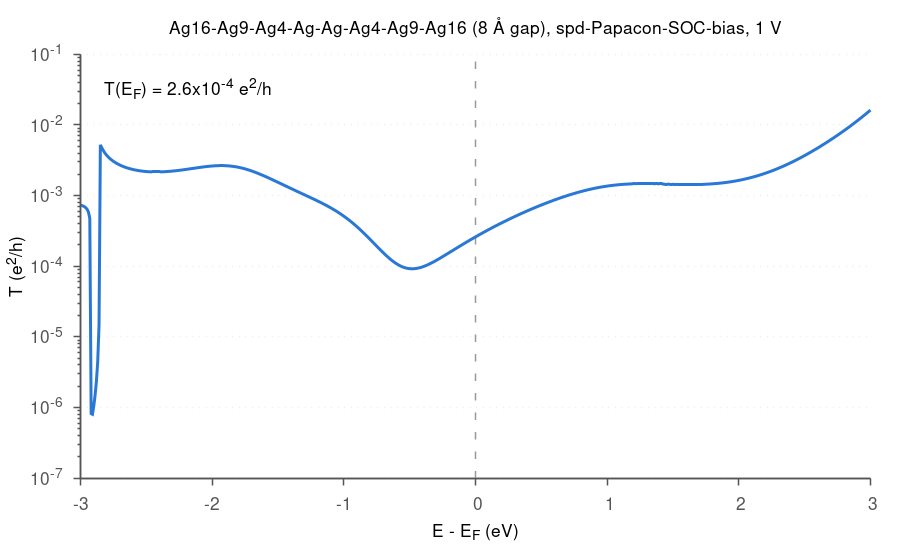

Ag tunnel junction (Ag16-Ag9-Ag4-Ag-Ag-Ag4-Ag9-Ag16, 60 atoms) between Bethe-lattice electrodes,
LSDA, with a minimal spd basis, spin-orbit coupling and a bias voltage.

Each atom has one contracted s, p and d shell and an ECP with a 36-electron core, given in the input
through `gen` and `pseudo=read`. The electrodes use the default Ag set `Papacon` of
`BLDAT/BL047.dat`.

## Running the example

Run `Ag16-Ag9-Ag4-Ag-Ag-Ag4-Ag9-Ag16.gjf` with `Ag16-Ag9-Ag4-Ag-Ag-Ag4-Ag9-Ag16.ant`, with
`scf=(conver=5,nodamp) symmetry=none`.

`.ant` settings: `ALPHA = 0.02`, `SOC` with `SOC_FAC_P/D/F = 100`, `ETA = 0.030`, `PACC = 1.0d-6`,
`CHARGEACC` and `FERMIACC` 1.0d-4, `BIASVOLT = 1.0`.

## Outputs

- `Ag16-Ag9-Ag4-Ag-Ag-Ag4-Ag9-Ag16.log`: the ANT run
- `T.Ag16-Ag9-Ag4-Ag-Ag-Ag4-Ag9-Ag16.SOC.dat`: transmission with SOC for E - E_F = -3 to 3 eV, in
  units of e^2/h
- `T.Ag16-Ag9-Ag4-Ag-Ag-Ag4-Ag9-Ag16.SOC.png`: plot of the transmission (log scale), shown below
- `Ag16-Ag9-Ag4-Ag-Ag-Ag4-Ag9-Ag16.xyz`: the geometry written by ANT

## Results

ANT.Gaussian 3.0.0, Gaussian 09 D.01, NVIDIA HPC SDK build, 8 threads, 13 November 2026, from
scratch.

| Quantity | Value |
|---|---|
| Basis functions | 540 |
| SCF energy (a.u.) | -2335.954314 |
| SCF cycles | 17 |
| Bethe-lattice Fermi energy (eV) | 6.560 |
| Device Fermi energy (eV) | -6.9195 |
| T(E_F) (e^2/h) | 0.00026 |
| Unsuccessful density integrations | 0 |
| Wall time | 501 s |

## Notes

- This example was called `Ag25-...`, but its geometry and title are
  Ag16-Ag9-Ag4-Ag-Ag-Ag4-Ag9-Ag16. With the old file names ANT looked for an `.ant` named after the
  title, did not find it and ran without SOC and bias; the files are renamed.
- SOC enters the transport calculation only (`SCFSOC = F`).
- The `.gjf` uses `%NProcShared=16`; change it to the number of cores available. It substitutes
  links from `../../../../bin`.
