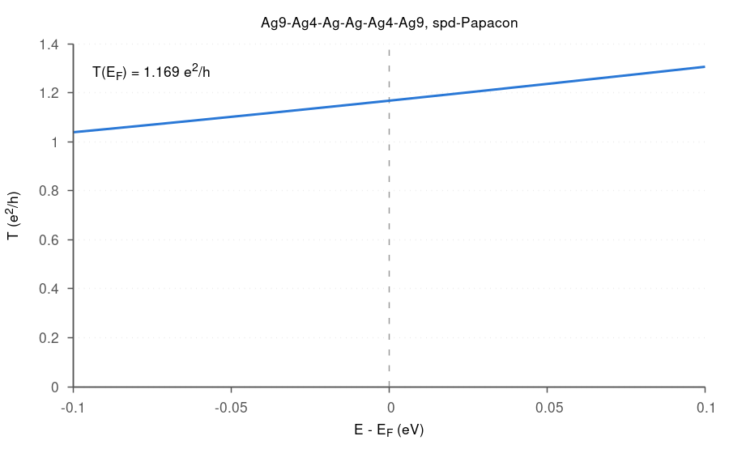

Ag nanocontact (Ag9-Ag4-Ag-Ag-Ag4-Ag9, 28 atoms) between Bethe-lattice electrodes, LSDA, with a
minimal spd basis.

Each atom has one contracted s, p and d shell and an ECP with a 36-electron core, given in the input
through `gen` and `pseudo=read`. The electrodes use the default Ag set `Papacon` of
`BLDAT/BL047.dat`.

## Running the example

Run `Ag9-Ag4-Ag-Ag-Ag4-Ag9.gjf` with `Ag9-Ag4-Ag-Ag-Ag4-Ag9.ant`, with
`scf=(conver=5,nodamp,dsymm)`.

`P.Ag9-Ag4-Ag-Ag-Ag4-Ag9.dat` from the run reported below is included. ANT reads it at start-up as
the initial density matrix, so running the input in this folder restarts from the converged density;
delete or move it to repeat the run from scratch.

`.ant` settings: `ALPHA = 0.05`, `SELFACC = 1.0d-5`, `PACC = 1.0d-6`, `CHARGEACC` and `FERMIACC`
1.0d-4, `EW1 = -0.1`, `EW2 = 0.1`.

## Outputs

- `Ag9-Ag4-Ag-Ag-Ag4-Ag9.log`: the ANT run
- `T.Ag9-Ag4-Ag-Ag-Ag4-Ag9.dat`: transmission for E - E_F = -0.1 to 0.1 eV (from `EW1` and `EW2`),
  in units of e^2/h
- `T.Ag9-Ag4-Ag-Ag-Ag4-Ag9.png`: plot of the transmission (linear scale), shown below
- `Ag9-Ag4-Ag-Ag-Ag4-Ag9.xyz`: the geometry written by ANT
- `P.Ag9-Ag4-Ag-Ag-Ag4-Ag9.dat`: the converged density matrix

## Results

ANT.Gaussian 3.0.0, Gaussian 09 D.01, NVIDIA HPC SDK build, 4 threads, 13 November 2026, from
scratch.

| Quantity | Value |
|---|---|
| Basis functions | 252 |
| SCF energy (a.u.) | -1089.835247 |
| SCF cycles | 12 |
| Bethe-lattice Fermi energy (eV) | 6.527 |
| Device Fermi energy (eV) | -7.2933 |
| T(E_F) (e^2/h) | 1.169 |
| Unsuccessful density integrations | 4 |
| Wall time | 16 s |

## Notes

- The result changes little from its earlier ANT 2.5.2 output (E = -1089.835708 a.u.,
  T(E_F) = 1.1687), although the earlier `Papacon` set had `edd` and `edt` swapped.
- The `.gjf` uses `%NProcShared=1`; change it to the number of cores available. It substitutes links
  from `../../../../bin`.
