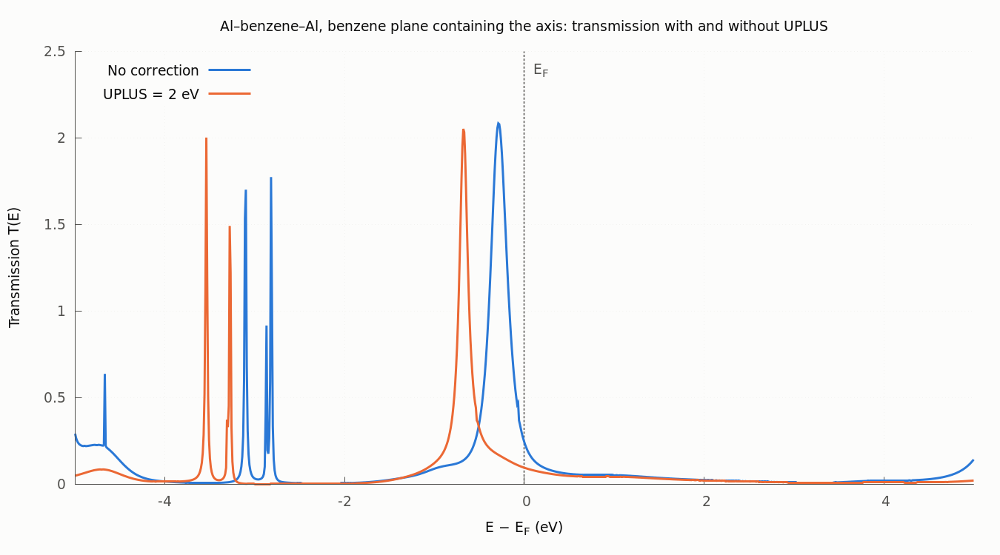
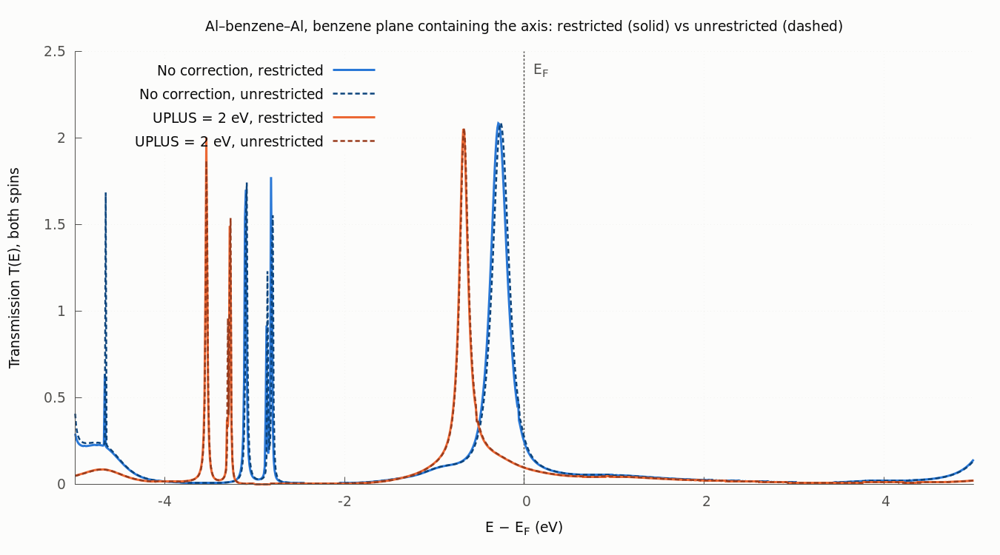

Benzene between the two Al pyramids of [../Al-benzene-Al](../Al-benzene-Al/README.md), rotated so
that the ring plane contains the C3 transport axis (z) with one C-C bond facing each tip (52 atoms),
BLYP, with an sp basis and ECP on Al and STO-3G on C and H, between `Papacon` Bethe-lattice
electrodes (`BLDAT/BL013.dat`).

The ring keeps the internal geometry of the flat, chemisorbed structure (C-C 1.43 A) and was turned
rigidly about its centre, from the x-y plane into the y-z plane, centred on the axis. Standing up,
the ring reaches 2.2 A along the axis, so the two electrodes were moved apart rigidly by 2.67 A each,
until the nearest H is 2.50 A from the apex Al: the apex gap grows from 3.34 to 8.69 A, and the
nearest C is 3.18 A from the apex (2.18 A for every C in the flat structure).

Each subdirectory is one variation of the calculation for this structure, with its own inputs,
outputs and README. All four run with `ALPHA = 0.02`, `EW1 = -5`, `EW2 = 5` and `MOLBLOCKS` set to
the benzene (atoms 21-32), so the molecular-gap correction can be switched on with `UPLUS` alone.

- [sp-Papacon/](sp-Papacon/README.md): spin-restricted BLYP, no gap correction.
- [sp-Papacon-UPLUS/](sp-Papacon-UPLUS/README.md): spin-restricted, `UPLUS = 2.0`.
- [sp-Papacon-UHF/](sp-Papacon-UHF/README.md): spin-unrestricted (`ublyp`, `guess=mix`), no gap
  correction.
- [sp-Papacon-UPLUS-UHF/](sp-Papacon-UPLUS-UHF/README.md): spin-unrestricted, `UPLUS = 2.0`.

## Results

ANT.Gaussian after 3.1.0 with the self-consistent `UPLUS` (see `CHANGELOG.md`), Gaussian 09 D.01,
Intel build, 12 threads, 18 November 2026, from scratch. T is summed over both spins, in units of
e^2/h.

| Quantity | Restricted | Restricted, `UPLUS = 2` | Unrestricted | Unrestricted, `UPLUS = 2` |
|---|---|---|---|---|
| Basis functions | 196 | 196 | 196 | 196 |
| SCF energy (a.u.) | -303.995173 | -304.003482 | -303.994777 | -303.987185 |
| SCF cycles | 140 | 114 | 135 | 139 |
| Device Fermi energy (eV) | -6.2499 | -6.2779 | -6.2380 | -6.2786 |
| HOMO resonance (eV) | -0.30 | -0.68 | -0.30 | -0.68 |
| T(E_F) | 0.240 | 0.094 | 0.266 | 0.095 |
| T at E_F - 1 eV / E_F + 1 eV | 0.089 / 0.052 | 0.123 / 0.043 | 0.090 / 0.051 | 0.120 / 0.043 |
| Wall time | 53 s | 35 s | 72 s | 70 s |

In this geometry BLYP with STO-3G places the occupied benzene pi pair (MOs 20-21) 0.3 eV below E_F,
and its resonance carries most of T(E_F). With `UPLUS = 2` the pair, occupied 0.99 per spin, is
shifted 1.0 eV down to -0.53 eV, and the LUMO up to +6.97 eV (gap 7.5 eV); self-consistency pulls the
resonance back to -0.68 eV, and T(E_F) drops by 60%. The molecule keeps 41.72 electrons.

The unrestricted runs give the same benzene levels and occupations for both spins and no spin
density on the ring. `guess=mix` leaves small opposite moments on the two Al tips (-0.01 to -0.06
per atom on one, +0.01 to +0.05 on the other; net -0.09 without and -0.03 with `UPLUS`), which split
the narrow resonances near -2.9 eV by spin in the run without the correction. Gaussian's S**2 of
about 9 is computed from its own orbitals, not from the density ANT returns, and does not describe
this state. The energies of different runs differ by more than ANT's SCF tolerance resolves; a rerun
of the restricted `UPLUS` case took 177 instead of 114 cycles, with the energy 0.17 mHartree apart
and two narrow resonances near -3.5 eV moved by 0.03 eV, T(E_F) 0.096 instead of 0.094.
