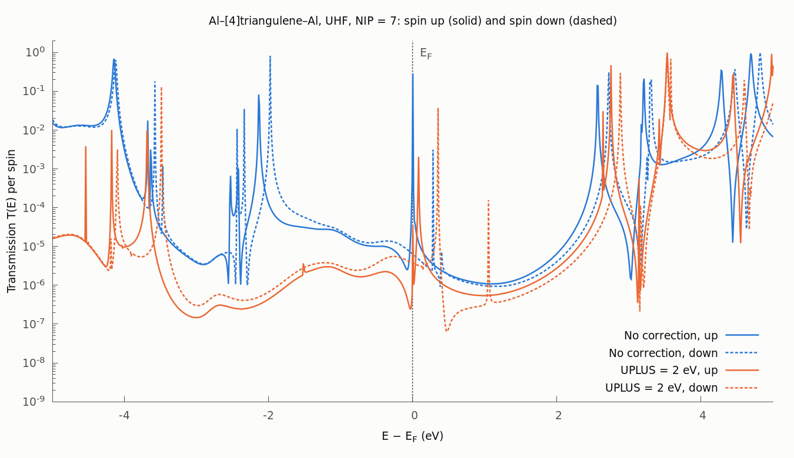

[4]Triangulene, C33H15, between two Al pyramids (88 atoms), spin-unrestricted BLYP, with an sp basis
and ECP on Al and STO-3G on C and H, between `Papacon` Bethe-lattice electrodes (`BLDAT/BL013.dat`).
340 basis functions.

The structure follows [../../Al-benzene-Al/Al-benzene-Al-axis](../../Al-benzene-Al/Al-benzene-Al-axis/README.md):
the molecule replaces the benzene, with its plane containing the C3 transport axis (z). `build.py`
builds the flake with C-C 1.42 A and C-H 1.09 A (no geometry optimization), centres its carbons on
the axis with the C3 median of the triangle along z (a corner C-H towards electrode 1, a zigzag edge
towards electrode 2), and moves each Al tip rigidly along z until the nearest H is 2.50 A from its
apex. The apex gap is 16.09 A; the nearest C is 3.49 A from an apex. Atoms 1-20 and 69-88 are the Al
tips, 21-68 the molecule (33 C, then 15 H).

Each subdirectory is one variation of the calculation for this structure, with its own inputs,
outputs and README. Both use `ALPHA = 0.02`, `NIP = 7`, `EW1 = -5`, `EW2 = 5` and `MOLBLOCKS` set to
atoms 21-68, and start from a quartet (charge 0, multiplicity 4).

- [sp-Papacon-UHF/](sp-Papacon-UHF/README.md): no gap correction.
- [sp-Papacon-UPLUS-UHF/](sp-Papacon-UPLUS-UHF/README.md): `UPLUS = 2.0`.

## Results

ANT.Gaussian after 3.1.0 with the self-consistent `UPLUS` (see `CHANGELOG.md`), Gaussian 09 D.01,
Intel build, 12 threads, 18 November 2026, from scratch. T in units of e^2/h per spin.

| Quantity | No correction | `UPLUS = 2` |
|---|---|---|
| SCF energy (a.u.) | -1325.301449 | -1325.296751 |
| SCF cycles | 78 | 43 |
| Device Fermi energy (eV) | -5.3685 | -5.1103 |
| Net spin on the molecule / on the Al tips (Mulliken) | 1.27 / 0.15 | 1.03 / 0.18 |
| Electrons on the molecule, up + down (Loewdin) | | 106.02 + 104.99 |
| T(E_F), up / down | 0.29 / 6.3e-6 | 3.6e-5 / 3.7e-6 |
| Unsuccessful density integrations (up to 255 points) | 362 | 62 |
| Wall time | 526 s | 234 s |

The molecule does not keep S = 3/2. The multiplicity of the `.gjf` only sets Gaussian's initial
guess; with the electrodes attached both spins share one Fermi level, and the flake gives about two
electrons to the Al (about 211 of its 213) and keeps about one unpaired spin. With BLYP and STO-3G
on C the zero-energy states of the flake lie close to the Al Fermi level; a partly filled one stays
pinned at E_F. Without the correction its spin-up resonance falls on E_F (T(E_F) = 0.29, on a very
narrow peak); with `UPLUS = 2` it is narrower and just off the E_F grid point, the occupied levels
move about 1 eV down (spin-up HOMO -0.54 -> -1.52 eV, spin-down -2.48 -> -3.48 eV, before and
after the shift), and the
background transmission drops by about a factor of 10. With the 16 A gap the junction tunnels:
T is 1e-7 to 1e-4 away from resonances.

The run without the correction reports many unsuccessful density integrations even with `NIP = 7`;
its narrow features are less reliable. With `NIP = 6`, the `UPLUS = 2` run reported 345 of them and
ended with net spin 1.12 and T(E_F) = 1.6e-5 / 2.9e-6.
