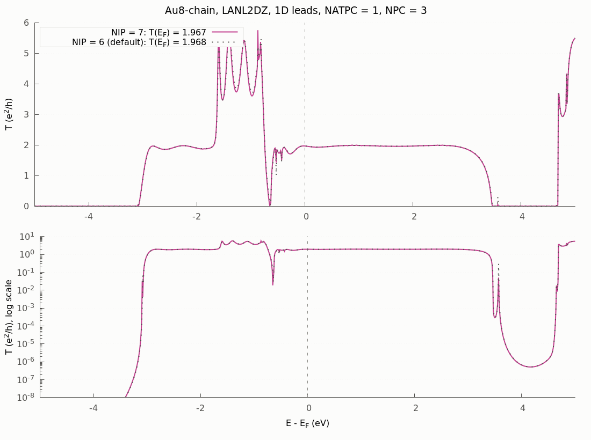

Au8-chain (8 atoms, 3 A spacing) between one-dimensional leads, LSDA, with the LANL2DZ basis and ECP
on all atoms (60-electron core, 19 valence electrons, double-zeta 5s5p5d6s; 22 functions per atom).

`.ant`: `TYPE1 = TYPE2 = 1DLEAD`, `NATPC1 = NATPC2 = 1`, `NPC = 3`, `CHARGEACC` and `FERMIACC`
1.0d-5, `PACC = 1.0d-7`, `EW1 = -5`, `EW2 = 5`, `ETA = 0.001`, `ALPHA = 0.01`, `NPULAY = 5`,
`SL = 0.01`, `NIP = 7`. Route: `lsda/lanl2dz pop=reg Scf=(conver=5,maxcycle=100,dsymm,nodamp)`,
`%NProcShared=8`. The lead settings are those of [../spd-1DLEAD](../spd-1DLEAD/README.md);
`NIP = 7` raises the maximum number of density-integration points from 127 to 255.

A run in this directory starts from `P.Au8-chain.dat` if present; delete it to start from scratch.

## Outputs

- `Au8-chain.log`
- `T.Au8-chain.dat`: transmission for E - E_F = -5 to 5 eV in 0.01 eV steps, in units of e^2/h
- `T.Au8-chain.png`: plot of the transmission, with the default `NIP = 6` run for comparison
- `P.Au8-chain.dat`: the density of this run
- `Au8-chain.xyz`: empty; ANT writes no geometry with 1D leads

## Results

ANT.Gaussian 3.0.0 with the bounded device Fermi search (see `BRENT.md`), Gaussian 09 D.01, NVIDIA
HPC SDK build, 8 threads, 16 November 2026, from scratch.

| Quantity | NIP = 7 (stored) | NIP = 6 (default) |
|---|---|---|
| Basis functions | 176 | 176 |
| SCF energy (a.u.) | -1085.173824 | -1085.174920 |
| SCF cycles | 36 | 36 |
| Lead Fermi energy (eV) | -8.2138 | -8.2138 |
| Device Fermi energy (eV) | -6.6671 | -6.6684 |
| T(E_F) (e^2/h) | 1.967 | 1.968 |
| T at E_F - 1 eV / E_F + 1 eV (e^2/h) | 3.661 / 1.985 | 3.769 / 1.985 |
| Unsuccessful density integrations | 22 (cycles 13-20) | 43 (spread over the run) |
| Charges (e), atoms 1-4 (symmetric) | -0.090, -0.013, +0.032, -0.002 | -0.088, -0.012, +0.031, -0.002 |
| Wall time | 103 s | 96 s |

The `NIP = 6` outputs are not stored; its curve is in the plot.

## Notes

- T(E_F) = 1.967 e^2/h: one open s channel. Unlike the minimal spd basis, the d bands lie just below
  E_F: from E - E_F = -1.6 to -0.8 eV T rises to about 5.8, with a narrow dip (0.02) at -0.65 eV
  between them and the s band. The s band carries T near 2 down to -3.1 eV; above E_F, T falls to
  zero from +3.5 to +4.6 eV. See the basis comparison in [../README.md](../README.md).
- With `NIP = 7` the last 12 density cycles have no unsuccessful integrations; with the default
  `NIP = 6` most of them had one. The results change by little: E_F by 1.3 meV, the energy by
  1.1 mEh, T by at most 0.54 e^2/h on the sharp d peaks at -0.87 eV.
- The device Fermi energy lies 1.55 eV above the lead one; with the minimal spd basis it lies
  1.43 eV below. The 1-atom lead unit taken from the 8-atom cluster is not bulk-like in either basis;
  compare with a longer chain.
- Muller fails inside the device energy window in the first three cycles; the secant (once) and
  bisection (twice) find the root.
