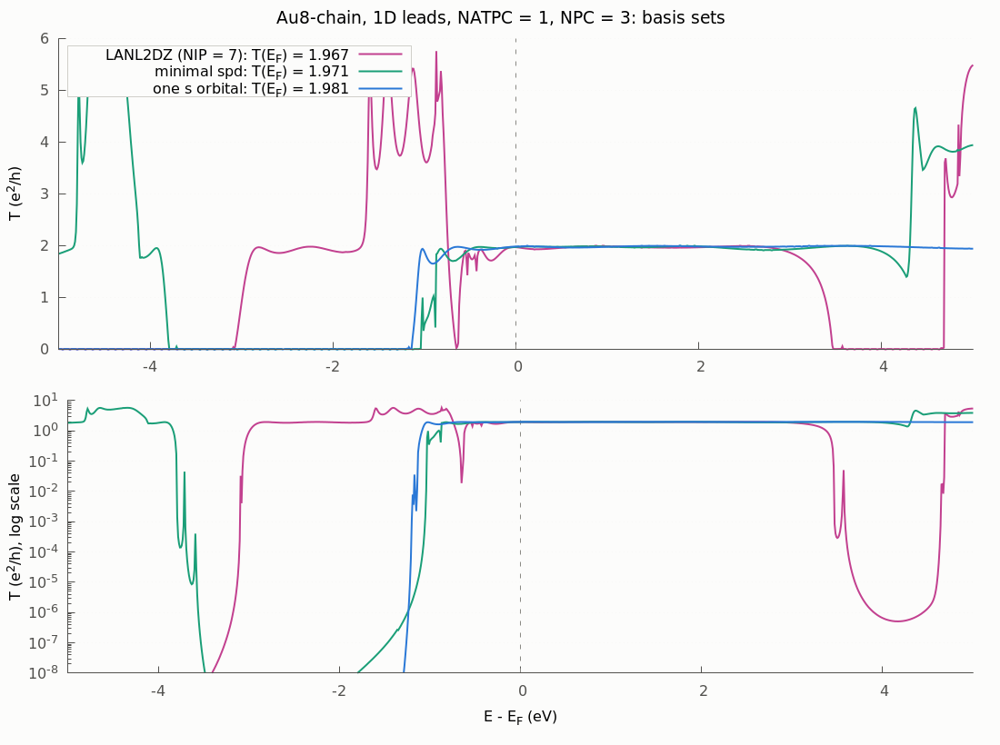
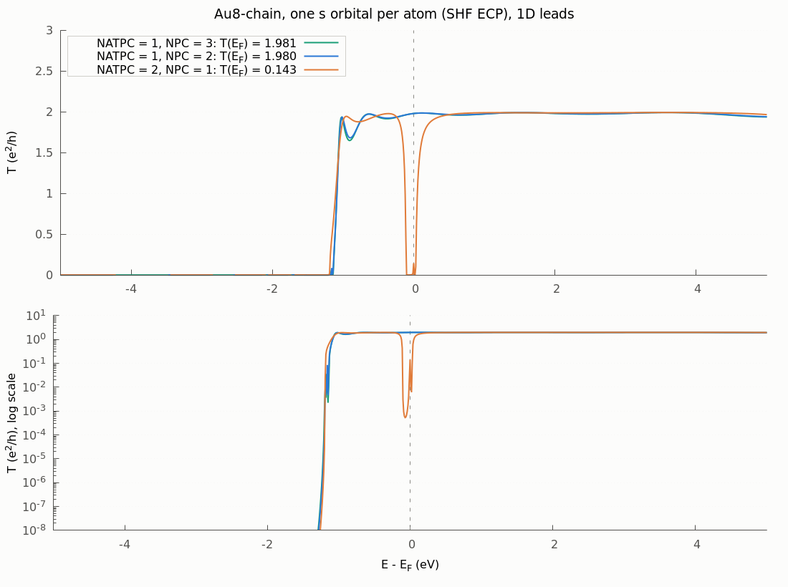

Au chain Au8-chain (8 atoms on the z axis, 3 A spacing) between one-dimensional leads, LSDA.

Each subdirectory is one variation of the calculation for this structure, with its own inputs,
outputs and README. The files keep the name of the system, `Au8-chain`.

- [spd-1DLEAD/](spd-1DLEAD/README.md): a minimal spd basis with a 68-electron ECP on all atoms,
  1-atom lead unit coupled over 3 cells.
- [LANL2DZ-1DLEAD/](LANL2DZ-1DLEAD/README.md): LANL2DZ on all atoms, the same leads as spd-1DLEAD,
  `NIP = 7`.
- [s-1DLEAD-NATPC1-NPC2/](s-1DLEAD-NATPC1-NPC2/README.md): one s orbital per atom (`SHF` ECP),
  1-atom lead unit coupled over 2 cells.
- [s-1DLEAD-NATPC1-NPC3/](s-1DLEAD-NATPC1-NPC3/README.md): the same over 3 cells.
- [s-1DLEAD-NATPC2-NPC1/](s-1DLEAD-NATPC2-NPC1/README.md): the same with a 2-atom lead unit.

## Comparison

| Variation | Basis and leads | E_F (eV) | T(E_F) (e^2/h) |
|---|---|---|---|
| [spd-1DLEAD/](spd-1DLEAD/README.md) | spd, `NATPC = 1`, `NPC = 3` | -6.2101 | 1.971 |
| [LANL2DZ-1DLEAD/](LANL2DZ-1DLEAD/README.md) | LANL2DZ, `NATPC = 1`, `NPC = 3` | -6.6671 | 1.967 |
| [s-1DLEAD-NATPC1-NPC2/](s-1DLEAD-NATPC1-NPC2/README.md) | s, `NATPC = 1`, `NPC = 2` | -2.8570 | 1.980 |
| [s-1DLEAD-NATPC1-NPC3/](s-1DLEAD-NATPC1-NPC3/README.md) | s, `NATPC = 1`, `NPC = 3` | -2.7779 | 1.981 |
| [s-1DLEAD-NATPC2-NPC1/](s-1DLEAD-NATPC2-NPC1/README.md) | s, `NATPC = 2`, `NPC = 1` | -2.9269 | 0.143 |

All three bases with the 1-atom lead unit give one open channel at E_F. The bands around it
differ: LANL2DZ puts the d bands just below E_F (-1.6 to -0.8 eV), where the minimal spd basis has
no transmission from -3.7 to -1.0 eV and its d bands below -3.8 eV.

With one s orbital per atom the 1-atom lead unit gives one open channel, and coupling over 3 cells
instead of 2 hardly changes it. The 2-atom unit opens a gap in the extracted lead just below E_F,
which drops T(E_F) to 0.143.

