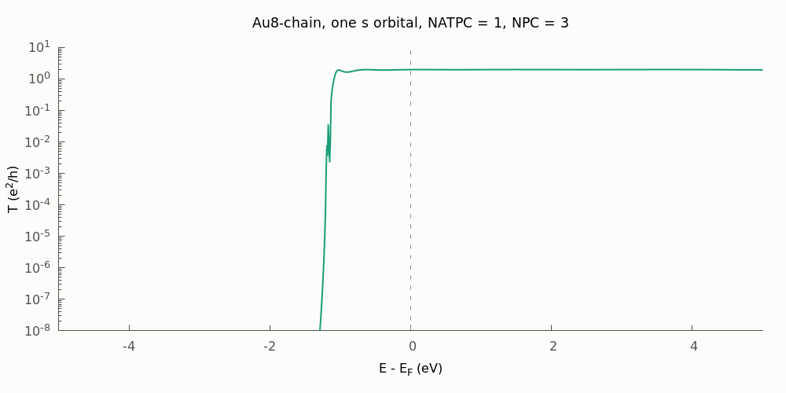

Au8-chain (8 atoms, 3 A spacing) between one-dimensional leads, LSDA, with one s orbital per atom.

Each atom has Gaussian's `SHF` ECP, which leaves one valence electron (6s), and one s shell of three
primitives (exponents 0.4409, 0.2626, 0.0617; the s shell of the
[../spd-1DLEAD](../spd-1DLEAD/README.md) basis). This is the basis of the `FCC-s` Bethe-lattice fit
(`BLDAT/fits/Au-FCC-s`).

`.ant`: `TYPE1 = TYPE2 = 1DLEAD`, `NATPC1 = NATPC2 = 1`, `NPC = 3`, `CHARGEACC` and `FERMIACC`
1.0d-5, `PACC = 1.0d-7`, `EW1 = -5`, `EW2 = 5`, `ETA = 0.001`, `ALPHA = 0.01`, `NPULAY = 5`,
`SL = 0.01`. Route: `lsda/gen pseudo=read pop=reg Scf=(conver=5,maxcycle=100,dsymm,nodamp)`,
`%NProcShared=8`.

## Outputs

- `Au8-chain.log`
- `T.Au8-chain.dat`: transmission for E - E_F = -5 to 5 eV in 0.01 eV steps, in units of e^2/h
- `T.Au8-chain.png`: plot of the transmission (log scale), shown below

## Results

ANT.Gaussian 3.0.0 with the bounded device Fermi search (see `BRENT.md`), Gaussian 09 D.01, NVIDIA
HPC SDK build, 8 threads, 16 November 2026.

| Quantity | Value |
|---|---|
| Basis functions | 8 |
| SCF energy (a.u.) | -1.795716 |
| SCF cycles | 17 |
| Lead Fermi energy (eV) | -2.6180 |
| Device Fermi energy (eV) | -2.7779 |
| T(E_F) (e^2/h) | 1.981 |
| T at E_F - 1 eV / E_F + 1 eV (e^2/h) | 1.882 / 1.974 |
| Unsuccessful density integrations | 0 |
| Charge of the end atoms (e) | +0.051 |

The run terminates normally in about 1 s.

## Notes

- Almost the same transmission as [../s-1DLEAD-NATPC1-NPC2](../s-1DLEAD-NATPC1-NPC2/README.md): the
  only visible difference is a slightly deeper dip near E - E_F = -0.95 eV. The device Fermi energy
  comes 0.08 eV closer to the lead one, and the end atoms lose slightly less charge.
- In the first cycle Muller and the secant step out of the device energy window (shifts of
  +62 and -2366 eV); the device Fermi search catches this and falls back to bisection. Without that
  guard the run stops with a failed 1D Dyson solve.
