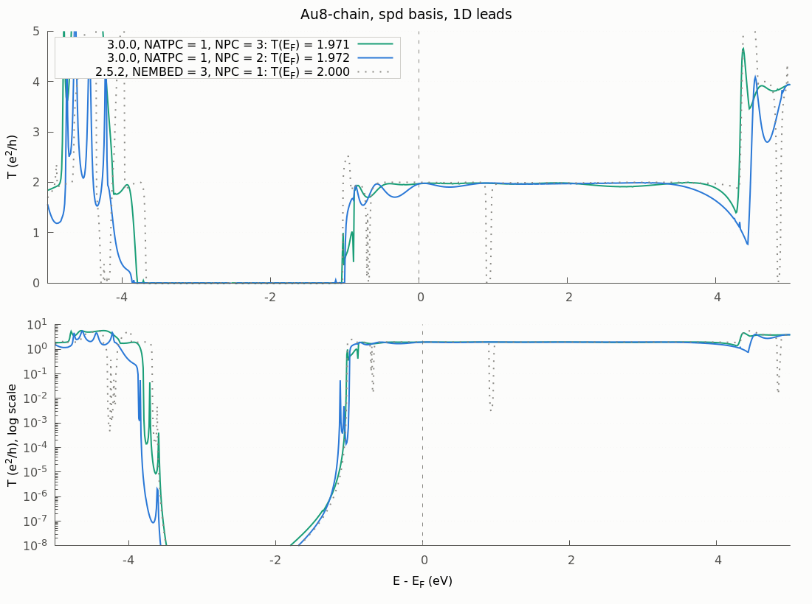

Au8-chain (8 atoms, 3 A spacing) between one-dimensional leads, LSDA, with a minimal spd basis and a
68-electron ECP (one s, p and d shell per atom, 11 valence electrons).

`.ant`: `TYPE1 = TYPE2 = 1DLEAD`, `NATPC1 = NATPC2 = 1`, `NPC = 3`, `CHARGEACC` and `FERMIACC`
1.0d-5, `PACC = 1.0d-7`, `EW1 = -5`, `EW2 = 5`, `ETA = 0.001`, `ALPHA = 0.01`, `NPULAY = 5`,
`SL = 0.01`. Route: `lsda/gen pseudo=read pop=reg Scf=(conver=5,maxcycle=100,dsymm,nodamp)`,
`%NProcShared=8`. The 1-atom lead unit follows the one-orbital runs of this chain, where a 2-atom
unit opens a gap at E_F (see [../README.md](../README.md)).

A run in this directory starts from `P.Au8-chain.dat` if present; delete it to start from scratch.

## Outputs

- `Au8-chain.log`
- `T.Au8-chain.dat`: transmission for E - E_F = -5 to 5 eV in 0.01 eV steps, in units of e^2/h
- `T.Au8-chain.png`: plot of the transmission, with the `NPC = 2` and ANT 2.5.2 runs for comparison
- `P.Au8-chain.dat`: the density of this run
- `Au8-chain.xyz`: empty; ANT writes no geometry with 1D leads

## Results

ANT.Gaussian 3.0.0 with the bounded device Fermi search (see `BRENT.md`), Gaussian 09 D.01, NVIDIA
HPC SDK build, 8 threads, 16 November 2026, from scratch.

| Quantity | NPC = 3 (stored) | NPC = 2 |
|---|---|---|
| Basis functions | 72 | 72 |
| SCF energy (a.u.) | -278.915414 | -278.869258 |
| SCF cycles | 37 | 19 |
| Lead Fermi energy (eV) | -4.7838 | -4.7959 |
| Device Fermi energy (eV) | -6.2101 | -6.0633 |
| T(E_F) (e^2/h) | 1.971 | 1.972 |
| T at E_F - 1 eV / E_F + 1 eV (e^2/h) | 0.464 / 1.978 | 0.008 / 1.985 |
| Unsuccessful density integrations | 4 | 0 |
| Charges (e), atoms 1-4 (symmetric) | +0.027, -0.054, -0.002, 0.000 | -0.038, +0.021, +0.011, -0.004 |
| Wall time | 6 s | 18 s |

The `NPC = 2` outputs are not stored; its curve is in the plot.

## Notes

- T(E_F) = 1.971 e^2/h: one open s channel, as for the one-orbital chain. T stays near 2 from
  E - E_F = -0.9 to +4.3 eV. Between -3.7 and -1.0 eV it vanishes (below 1e-8 for most of it); below
  -3.8 eV and above +4.3 eV the d and p bands of the leads add channels, with T up to about 4.
- Coupling the 1-atom lead unit over 3 cells instead of 2 lowers the energy by 46 mEh, flattens T
  near 2 and moves the band edges to those of the ANT 2.5.2 run, but needs more SCF cycles.
- The device Fermi energy lies 1.43 eV below the lead one (1.27 eV with `NPC = 2`). The lead unit is
  taken from the cluster, whose end atoms are not bulk-like; with only 8 atoms this offset is large,
  and the result should be compared with a longer chain.
- In the first cycle Muller and the secant step out of the device energy window (shifts of -261 and
  -866 eV); the device Fermi search catches this and bisection finds the root. In one later cycle
  Muller fails inside the window and the secant finds the root.
- The previous outputs came from ANT 2.5.2 with `NPC = 1`, `NEMBED1 = NEMBED2 = 3` (lead E_F
  -6.4768 eV, device E_F -6.5151 eV, T(E_F) = 2.000). Its transmission has narrow dips at -0.7 and
  +0.9 eV that the 1-atom lead does not have. It is the dotted curve of the plot.
