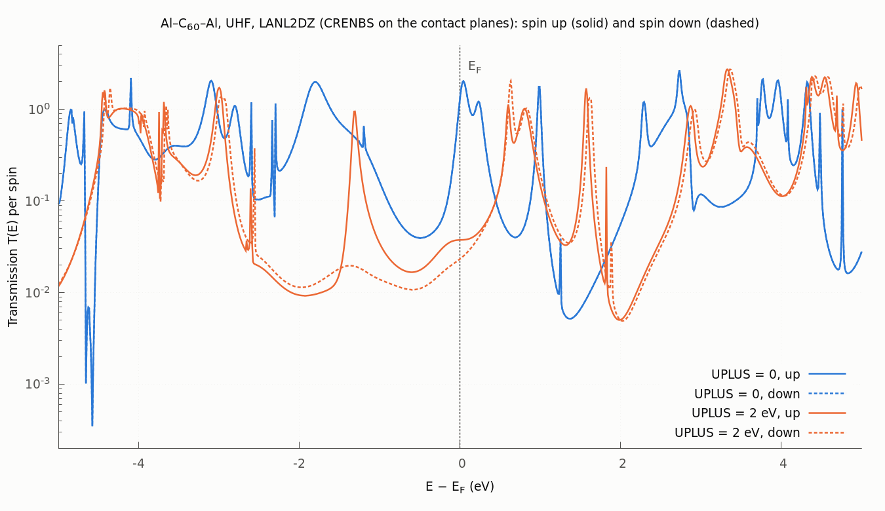

C60 between two Al pyramids (100 atoms), spin-unrestricted BLYP, between `Papacon` Bethe-lattice
electrodes (`BLDAT/BL013.dat`). 780 basis functions.

`build.py` builds the C60 as a truncated icosahedron with all C-C bonds 1.44 A (no geometry
optimization), with a hexagon facing each apex on the transport axis (z), and takes the Al tips of
[../../benzene/Al-benzene-Al/sp-Papacon](../../benzene/Al-benzene-Al/sp-Papacon/README.md),
moving each rigidly along z until the nearest C is 2.50 A from its apex (2.05 A from the apex to
the hexagon plane). The apex gap is 10.62 A. Atoms 1-20 and 81-100 are the Al tips, 21-80 the C60.

Basis and ECP, assigned by atom number in the `gen` and `pseudo=read` sections:

- atoms 1-10 and 91-100, the Al planes coupled to the Bethe lattice: the CRENBS sp basis (one
  contracted s and one p shell) with the Christiansen-Ermler ECP10CE, written out because Gaussian 09
  has no `CRENBS` keyword. This is the basis the `Papacon` Al parameters were fitted with.
- atoms 11-20 and 81-90 (the rest of the Al): LANL2DZ with its ECP.
- C: LANL2DZ.

Each subdirectory is one variation of the calculation for this structure, with its own inputs,
outputs and README. Both use `ALPHA = 0.02`, `NIP = 7`, `EW1 = -5`, `EW2 = 5` and `MOLBLOCKS` set to
atoms 21-80, and start from a singlet with `guess=mix` (charge 0, multiplicity 1).

- [sp-Papacon-UHF/](sp-Papacon-UHF/README.md): no gap correction.
- [sp-Papacon-UPLUS-UHF/](sp-Papacon-UPLUS-UHF/README.md): `UPLUS = 2.0`.

## Results

ANT.Gaussian after 3.1.0 with the self-consistent `UPLUS` (see `CHANGELOG.md`), Gaussian 09 D.01,
Intel build, 12 threads, 18 November 2026, from scratch. T in units of e^2/h per spin.

| Quantity | No correction | `UPLUS = 2` |
|---|---|---|
| SCF energy (a.u.) | -2360.981015 | -2360.975460 |
| SCF cycles | 52 | 67 |
| Device Fermi energy (eV) | -5.4918 | -5.3955 |
| Charge on the C60 (Mulliken) | -1.13 | -1.15 |
| Net spin on the C60 / on the Al tips (Mulliken) | 0.00 / 0.00 | 0.91 / -0.03 |
| Electrons on the C60, up + down (Loewdin) | | 180.68 + 179.76 |
| T(E_F), up / down | 1.38 / 1.38 | 0.038 / 0.023 |
| Unsuccessful density integrations (up to 255 points) | 0 | 5 |
| Wall time | 3131 s | 3827 s |

The C60 takes about one electron from the Al in both runs. Without the correction the solution is
spin-symmetric (the `guess=mix` symmetry breaking does not survive): the threefold t1u LUMO sits at
E_F, partly filled and broadened by the contacts, and T reaches 2 per spin within a few tenths of an
eV of E_F. With `UPLUS = 2` the extra electron localizes in one t1u orbital of one spin, a
C60(-)-like state with S of about 1/2: the occupied spin-up t1u orbital (MO 182) moves from -0.31 to
-1.26 eV (E - E_F, before and after the shift), the other two to +0.63 eV, and the empty spin-down
t1u to +0.65 eV. E_F then falls between resonances and T(E_F) drops by a factor of 40-60.

The energies of the two runs are not comparable: with `UPLUS` the energy Gaussian prints does not
include the correction of the Hamiltonian.
