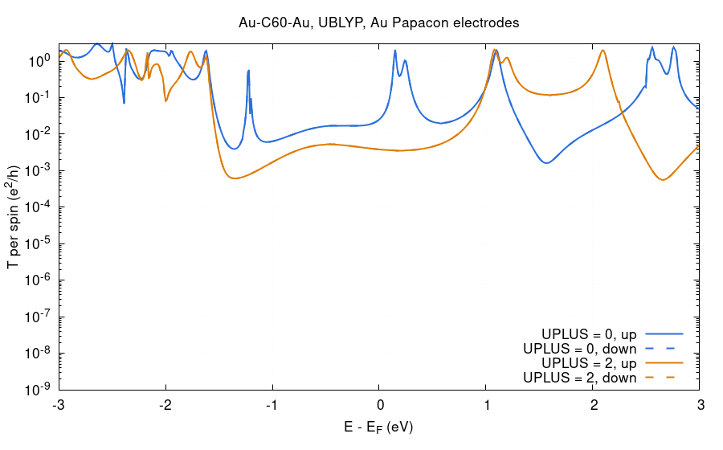

C60 between two Au pyramids (100 atoms), spin-unrestricted BLYP,
between `Papacon` Bethe-lattice electrodes (`BLDAT/BL079.dat`). 1160 basis functions.

The structure is [../Al-C60-Al](../Al-C60-Al/README.md) with Au in place of Al. `build.py` reads
an input of Al-C60-Al, scales each 20-atom Al pyramid about its apex from the Al spacing
of those inputs (nearest neighbours 2.496 A) to Au (2.884 A), and moves it rigidly along the
transport axis (z) until the nearest atom of the molecule is 2.50 A from its apex, as for Al; the
molecule is unchanged. The apex gap is 10.62 A. Atoms 1-20 and 81-100 are the Au tips,
21-80 the molecule.

Basis and ECP, assigned by atom number in the `gen` and `pseudo=read` sections:

- atoms 1-10 and 91-100, the Au planes coupled to the Bethe lattice: the CRENBS minimal spd
  basis (one s, one p and one d shell, 9 functions) with its 68-electron ECP, as in
  [../input_Electrodo_Au_3_benzene](../../benzene/input_Electrodo_Au_3_benzene/README.md). The 9-orbital
  `Papacon` Au set needs this basis.
- atoms 11-20 and 81-90 (the rest of the Au): LANL2DZ with its ECP.
- C and H: LANL2DZ.

Each subdirectory is one variation of the calculation for this structure, with its own inputs,
outputs and README. Both use `ALPHA = 0.02`, `NIP = 7`, `EW1 = -5`, `EW2 = 5` and `MOLBLOCKS` set to
atoms 21-80, and start from a singlet with `guess=mix` (charge 0, multiplicity 1).

- [spd-Papacon-UHF/](spd-Papacon-UHF/README.md): no gap correction.
- [spd-Papacon-UPLUS-UHF/](spd-Papacon-UPLUS-UHF/README.md): `UPLUS = 2.0`.

## Results

ANT.Gaussian 3.2.0, Gaussian 09 D.01, Intel build, two runs at a time with 12 threads each,
18 November 2026, from scratch. T in units of e^2/h per spin.

| Quantity | No correction | `UPLUS = 2` |
|---|---|---|
| SCF energy (a.u.) | -5686.028654 | -5685.995164 |
| SCF cycles | 49 | 44 |
| Device Fermi energy (eV) | -6.3725 | -6.4320 |
| Charge on the C60 (Mulliken) | +0.78 | +0.41 |
| Net spin on the C60 / on the Au tips (Mulliken) | 0.00 / 0.00 | 0.00 / 0.00 |
| Electrons on the C60, up + down (Loewdin) | | 179.49 + 179.49 |
| T(E_F), up / down | 2.5e-2 / 2.5e-2 | 3.8e-3 / 3.8e-3 |
| Unsuccessful density integrations (up to 255 points) | 9 | 0 |
| Wall time | 11961 s | 10861 s |

Unlike with Al, where the C60 took about one electron and half-filled its t1u LUMO, the C60 takes
no electron from the Au, whose Fermi level (-6.4 eV) is about 1 eV deeper, and stays nonmagnetic.
Without the correction the t1u LUMO resonance lies about 0.15 eV above E_F; `UPLUS = 2` moves the
HOMO from -0.86 to -1.72 eV and the LUMO from +0.34 to +1.28 eV (E - E_F, before and after the
shift), and T(E_F) drops by a factor of 6.6. Mulliken and Loewdin both put a positive charge on the
C60 (Loewdin 358.98 of 360 electrons); with the diffuse LANL2DZ Au basis this partition is not
reliable, and only the trend between the two runs should be read from it.

The energies of the two runs are not comparable: with `UPLUS` the energy Gaussian prints does not
include the correction of the Hamiltonian.
