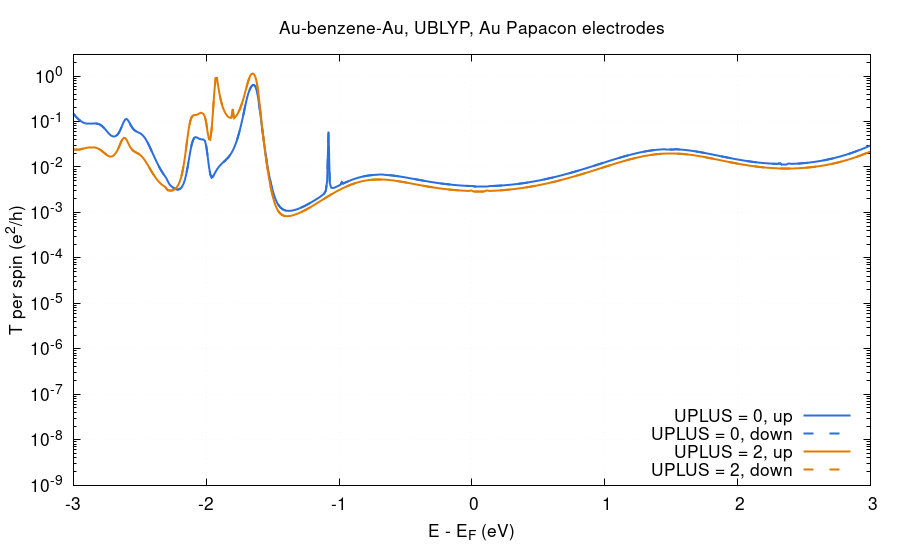

Benzene between two Au pyramids (52 atoms), spin-unrestricted BLYP,
between `Papacon` Bethe-lattice electrodes (`BLDAT/BL079.dat`). 686 basis functions.

The structure is [../Al-benzene-Al-axis](../Al-benzene-Al-axis/README.md) with Au in place of Al. `build.py` reads
an input of Al-benzene-Al-axis, scales each 20-atom Al pyramid about its apex from the Al spacing
of those inputs (nearest neighbours 2.496 A) to Au (2.884 A), and moves it rigidly along the
transport axis (z) until the nearest atom of the molecule is 2.50 A from its apex, as for Al; the
molecule is unchanged. The apex gap is 8.69 A. Atoms 1-20 and 33-52 are the Au tips,
21-32 the molecule.

Basis and ECP, assigned by atom number in the `gen` and `pseudo=read` sections:

- atoms 1-10 and 43-52, the Au planes coupled to the Bethe lattice: the CRENBS minimal spd
  basis (one s, one p and one d shell, 9 functions) with its 68-electron ECP, as in
  [../input_Electrodo_Au_3_benzene](../input_Electrodo_Au_3_benzene/README.md). The 9-orbital
  `Papacon` Au set needs this basis.
- atoms 11-20 and 33-42 (the rest of the Au): LANL2DZ with its ECP.
- C and H: LANL2DZ.

Each subdirectory is one variation of the calculation for this structure, with its own inputs,
outputs and README. Both use `ALPHA = 0.02`, `NIP = 7`, `EW1 = -5`, `EW2 = 5` and `MOLBLOCKS` set to
atoms 21-32, and start from a singlet with `guess=mix` (charge 0, multiplicity 1).

- [spd-Papacon-UHF/](spd-Papacon-UHF/README.md): no gap correction.
- [spd-Papacon-UPLUS-UHF/](spd-Papacon-UPLUS-UHF/README.md): `UPLUS = 2.0`.

## Results

ANT.Gaussian 3.2.0, Gaussian 09 D.01, Intel build, two runs at a time with 12 threads each,
18 November 2026, from scratch. T in units of e^2/h per spin.

| Quantity | No correction | `UPLUS = 2` |
|---|---|---|
| SCF energy (a.u.) | -3633.324407 | -3633.319560 |
| SCF cycles | 37 | 37 |
| Device Fermi energy (eV) | -6.7229 | -6.7349 |
| Charge on the benzene (Mulliken) | +0.38 | +0.32 |
| Net spin on the benzene / on the Au tips (Mulliken) | 0.00 / 0.00 | 0.00 / 0.00 |
| Electrons on the benzene, up + down (Loewdin) | | 20.85 + 20.85 |
| T(E_F), up / down | 3.8e-3 / 3.8e-3 | 3.0e-3 / 3.0e-3 |
| Unsuccessful density integrations (up to 255 points) | 4 | 0 |
| Wall time | 1428 s | 1385 s |

Benzene stays closed-shell and gives about 0.3-0.4 electrons to the Au (Mulliken), and the HOMO
lies closer to E_F than with Al. `UPLUS = 2` moves the HOMO from -0.82 to -1.79 eV and the LUMO
from +4.07 to +5.07 eV (E - E_F, before and after the shift); T(E_F) drops by about 20 %, less than
with Al (a factor of 2.5), because E_F sits in the middle of a wide gap where the tunnelling
background changes little.

The energies of the two runs are not comparable: with `UPLUS` the energy Gaussian prints does not
include the correction of the Hamiltonian.
