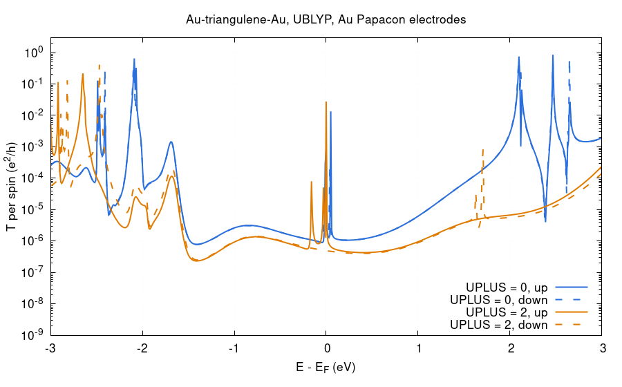

[4]Triangulene, C33H15, between two Au pyramids (88 atoms), spin-unrestricted BLYP,
between `Papacon` Bethe-lattice electrodes (`BLDAT/BL079.dat`). 947 basis functions.

The structure is [../Al-triangulene-Al](../Al-triangulene-Al/README.md) with Au in place of Al. `build.py` reads
an input of Al-triangulene-Al, scales each 20-atom Al pyramid about its apex from the Al spacing
of those inputs (nearest neighbours 2.496 A) to Au (2.884 A), and moves it rigidly along the
transport axis (z) until the nearest atom of the molecule is 2.50 A from its apex, as for Al; the
molecule is unchanged. The apex gap is 16.09 A. Atoms 1-20 and 69-88 are the Au tips,
21-68 the molecule.

Basis and ECP, assigned by atom number in the `gen` and `pseudo=read` sections:

- atoms 1-10 and 79-88, the Au planes coupled to the Bethe lattice: the CRENBS minimal spd
  basis (one s, one p and one d shell, 9 functions) with its 68-electron ECP, as in
  [../input_Electrodo_Au_3_benzene](../../benzene/input_Electrodo_Au_3_benzene/README.md). The 9-orbital
  `Papacon` Au set needs this basis.
- atoms 11-20 and 69-78 (the rest of the Au): LANL2DZ with its ECP.
- C and H: LANL2DZ.

Each subdirectory is one variation of the calculation for this structure, with its own inputs,
outputs and README. Both use `ALPHA = 0.02`, `NIP = 7`, `EW1 = -5`, `EW2 = 5` and `MOLBLOCKS` set to
atoms 21-68, and start from a quartet (charge 0, multiplicity 4).

- [spd-Papacon-UHF/](spd-Papacon-UHF/README.md): no gap correction.
- [spd-Papacon-UPLUS-UHF/](spd-Papacon-UPLUS-UHF/README.md): `UPLUS = 2.0`.

## Results

ANT.Gaussian 3.2.0, Gaussian 09 D.01, Intel build, two runs at a time with 12 threads each,
18 November 2026, from scratch. T in units of e^2/h per spin.

| Quantity | No correction | `UPLUS = 2` |
|---|---|---|
| SCF energy (a.u.) | -4667.072342 | -4667.135131 |
| SCF cycles | 73 | 66 |
| Device Fermi energy (eV) | -6.0798 | -6.1426 |
| Charge on the flake (Mulliken) | +1.18 | +0.91 |
| Net spin on the flake / on the Au tips (Mulliken) | -0.04 / 0.06 | 2.01 / -0.05 |
| Electrons on the flake, up + down (Loewdin) | | 107.02 + 105.02 |
| T(E_F), up / down | 8.4e-4 / 2.2e-4 | 2.8e-2 / 4.9e-7 |
| Unsuccessful density integrations (up to 255 points) | 244 | 200 |
| Wall time | 16589 s | 16383 s |

The flake gives about one electron to the Au in both runs (with Al it gave about two). Without
the correction it ends nonmagnetic. With `UPLUS = 2` it keeps about two unpaired spins (S of about
1, not the 3/2 of the free molecule): the spin-up zero-energy states are filled, one of them only
partly and pinned at E_F, the spin-down ones are empty, and the spin-down levels are pushed 2.4 eV
below and 1.6 eV above E_F. The junction is then almost fully spin-polarized at E_F (T up / T down of about
6e4). Both runs report a few hundred unsuccessful density integrations even with `NIP = 7`, so the
narrow features of T are not quantitative.

The energies of the two runs are not comparable: with `UPLUS` the energy Gaussian prints does not
include the correction of the Hamiltonian.
